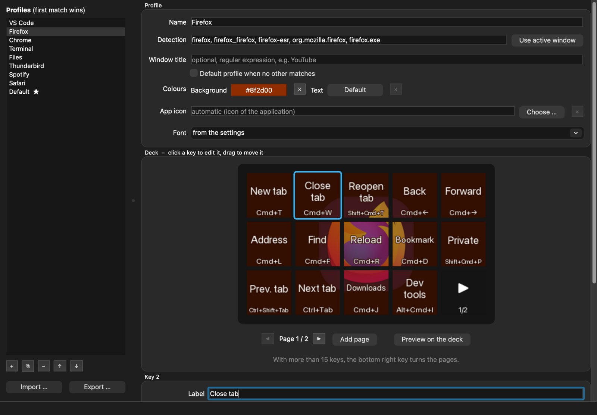

# Daily Deck

Turns an Elgato Stream Deck into a shortcut pad that follows you around: whenever another
application gets the focus, the deck shows that application's shortcuts. Press a key, and the
shortcut is sent – matching your keyboard layout.



- **A profile per application** – VS Code, browsers, terminal, file manager, mail, Spotify and a
  default profile come ready to use. More than 15 shortcuts? The last key turns the pages.
- **One configuration for every system** – `primary` is ⌘ on the Mac and Ctrl elsewhere, so a deck
  plugged into a monitor works the same with whichever computer is connected.
- **Profile editor** with live preview on the device, shortcut recording, built-in key
  symbols and profile import/export.
- **App icon across the deck** – flashes up on a switch, then shines through the keys.
- **Linux, macOS and Windows**, **English and German** (more welcome).

Works with the Stream Deck models supported by
[python-elgato-streamdeck](https://github.com/abcminiuser/python-elgato-streamdeck); tested with
the Stream Deck MK.2. Not affiliated with Elgato or Corsair.

## Install

Downloads are on the [releases page](https://github.com/thnow/dailydeck/releases). Quit the
Elgato software first – only one program can use the deck.

**Ubuntu 26.04** – `sudo apt install ./dailydeck_<version>_all.deb`, then start *Daily Deck* from
the app menu. On GNOME it sets up a small shell extension to see the focused window; on Wayland
that takes effect after logging out and in once.

**macOS 12 or later, Apple Silicon** – open `DailyDeck-<version>-macos-arm64.dmg` and drag
*Daily Deck* to *Applications*. On first start, allow it under System Settings → Privacy &
Security → **Accessibility**, otherwise it cannot send key presses.

**Windows 10 (1809) or later, 64 bit** – run `DailyDeck-<version>-windows-x64-setup.exe`. It needs no
admin rights and can start Daily Deck at sign-in. If SmartScreen warns about an unknown publisher:
*More info → Run anyway*.

**From source** (other distributions, development) – see [CONTRIBUTING.md](CONTRIBUTING.md).

## Use

Daily Deck runs in the menu bar or system tray. The menu shows the active app and profile and
lets you edit (or create) the profile for that app, pause, pin a profile regardless of the
focused window (e.g. Spotify), set the brightness and start at login.

In the **editor**, profiles are checked from top to bottom; ★ marks the default profile.
*Use active window* fills in the identifiers of an app: click it and switch to the app within
3 seconds. Click a key in the deck preview to edit it, drag to move it, right-click to clear it.
*Record* captures a shortcut; Ctrl (⌘ on the Mac) is stored as `primary`.

## Configuration

Everything lives in one file that is reloaded as soon as it is saved:

| System | Location |
|---|---|
| Linux | `~/.config/dailydeck/config.toml` |
| macOS | `~/Library/Application Support/dailydeck/config.toml` |
| Windows | `%APPDATA%\dailydeck\config.toml` |

It is created from [`default_config.toml`](dailydeck/data/default_config.toml), which documents
every option. A profile looks like this:

```toml
[[profiles]]
name = "Firefox"
match = ["firefox", "org.mozilla.firefox", "firefox.exe"]   # Linux, macOS, Windows
color = "#8f2d00"

  [[profiles.buttons]]
  label = "New tab"
  keys = "primary+t"           # ⌘T on the Mac, Ctrl+T elsewhere

  [[profiles.buttons]]
  label = "Back"
  keys = "alt+left"
  keys_macos = "cmd+left"      # only on the Mac
```

Profiles can be shared as `.dailydeck` files (*Export* / *Import* in the editor).

### Same profiles on every computer

*File → Synchronisation* moves the configuration (and its images) into a folder that Nextcloud,
OneDrive, Syncthing or a Git repository keeps in sync; on the other computers choose the same
folder and *Use* the configuration found there. Brightness, language, font and keyboard settings
stay with each computer, in `local.toml` next to the local configuration. With Git, commit and
pull yourself – Daily Deck picks up the changed file right away.

| Command | |
|---|---|
| `dailydeck --print-focus` | identifiers of the focused window, for `match` (Windows: `dailydeck.exe` in the install folder) |
| `dailydeck --dry-run "primary+/"` | which physical keys a shortcut would press |
| `dailydeck --preview DIR` | render all profiles as PNG images, without a device |

## Contributing

Bug reports, profiles for more applications and translations are welcome.
[CONTRIBUTING.md](CONTRIBUTING.md) covers the development setup,
[docs/TRANSLATING.md](docs/TRANSLATING.md) how to add a language.

## Thanks

Daily Deck stands on the work of people who share their code freely: Qt and Qt for Python,
Pillow, [python-elgato-streamdeck](https://github.com/abcminiuser/python-elgato-streamdeck),
[hidapi](https://github.com/libusb/hidapi), the [Lucide](https://lucide.dev) and Feather icons,
Python, PyInstaller and Inno Setup. Thank you – this tool would not exist without you.

## License

[GPL-3.0-or-later](LICENSE). The key symbols come from [Lucide](https://lucide.dev)
([ISC license](dailydeck/data/symbols/LICENSE)). The Windows and macOS builds include third-party
software; its licenses are in `THIRD-PARTY-NOTICES.txt` next to the program (in the app bundle:
`Contents/Resources`). Stream Deck is a trademark of Corsair Memory, Inc.
